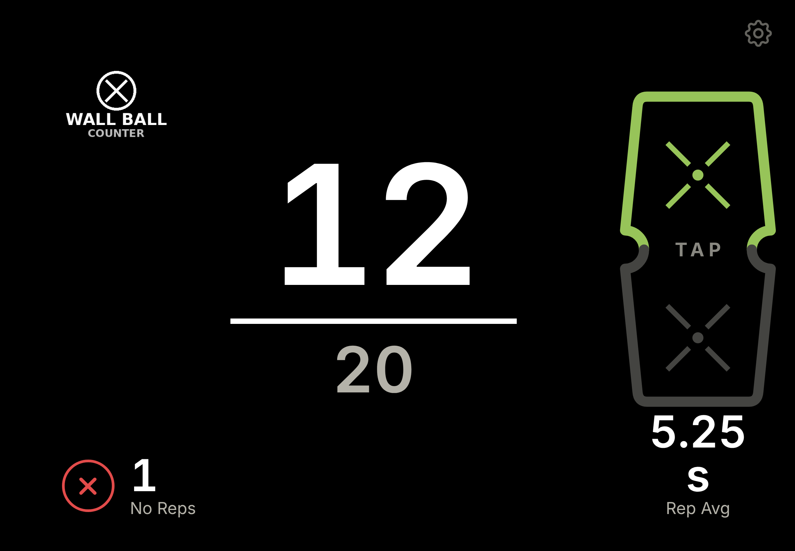
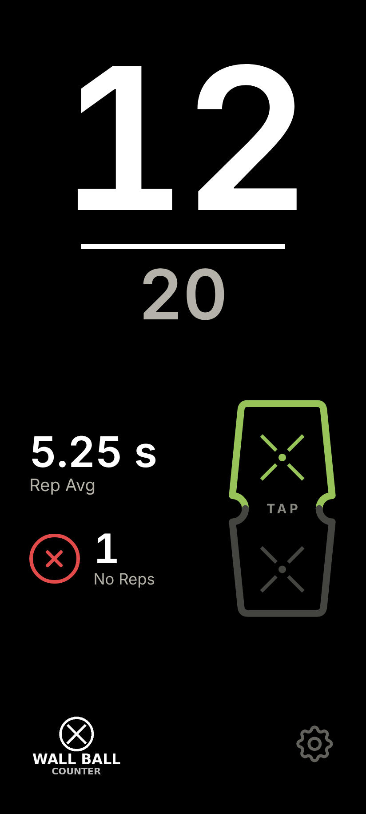
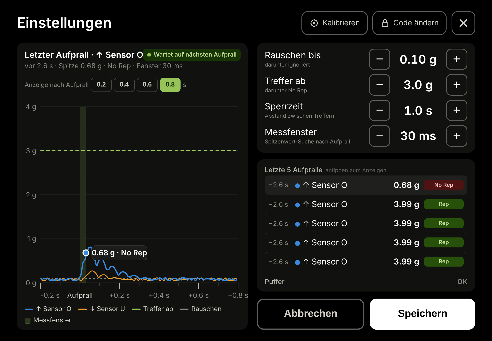
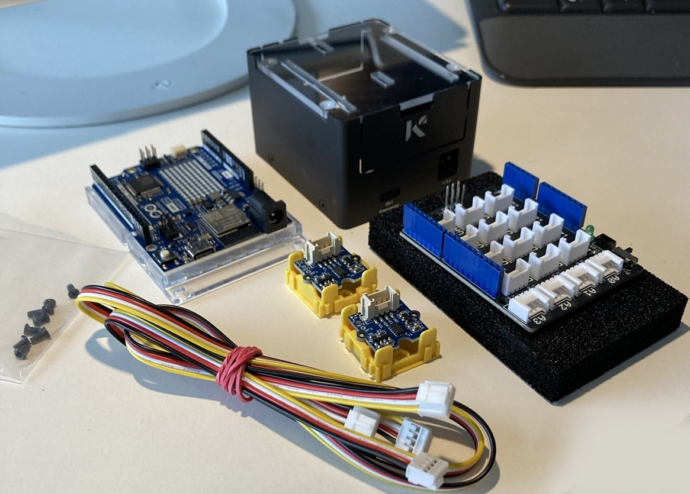
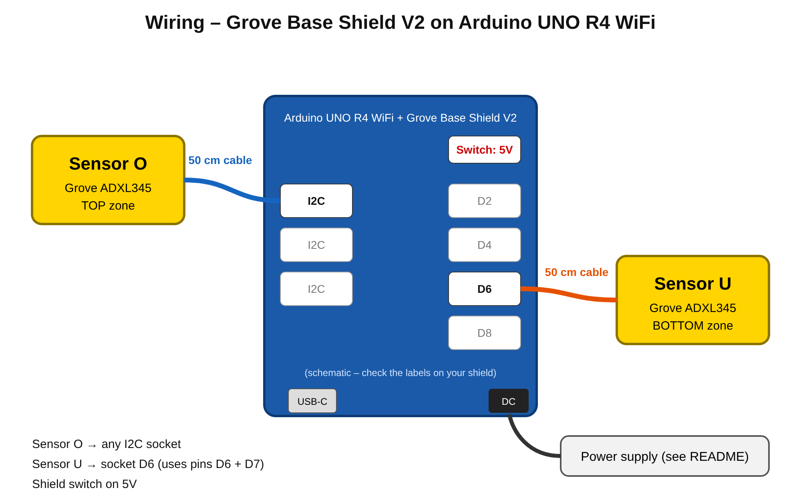
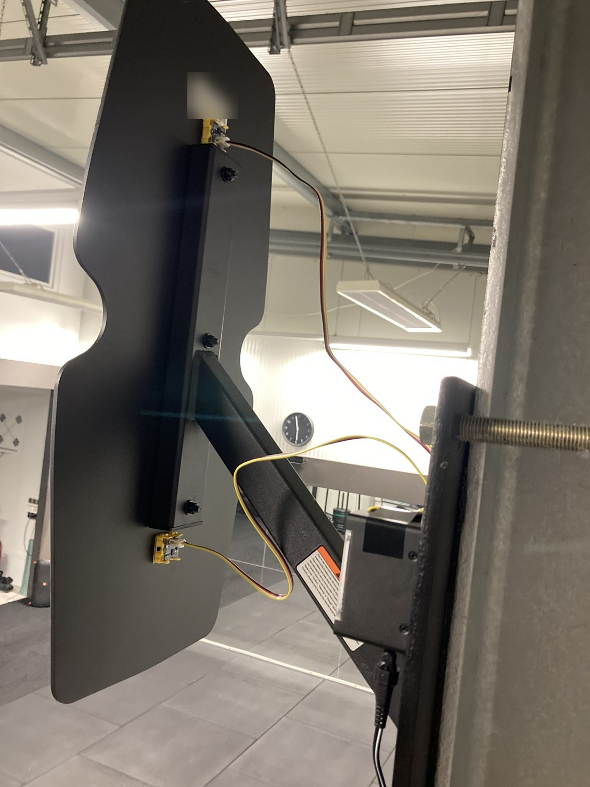
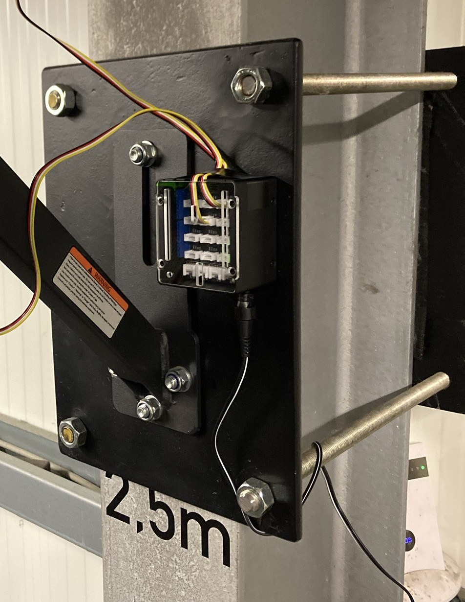

# Arduino Wall Ball Counter

A wall ball target counter built on an **Arduino UNO R4 WiFi** and two **ADXL345 accelerometers**. The sensors on the back of the target detect every impact. The Arduino counts reps and no reps by impact strength and serves a live scoreboard from its **own WiFi hotspot**, so any tablet or phone with a browser can show it. No router, no internet, no app.

| Landscape (tablet) | Portrait (phone) | Settings |
|---|---|---|
|  |  |  |

*(The scoreboard text on the settings page is German; the logo is a neutral placeholder, see [Your own logo](#your-own-logo).)*

## Features

- Counts **reps** (strong enough impact) and **no reps** (impact too weak), with a goal (20 / 40 / 60 / 80 / 100) and the average time per rep
- Two zones (top and bottom of the target). Only the sensor of the **active zone** counts, you choose the zone by tapping it on the screen
- Green or red border flashes on every rep / no rep, "GO!" when the goal is reached
- Settings page (code protected): noise limit, hit threshold, lockout time, measuring window, plus a live graph of the last impact and a list of the last five impacts
- **Auto-zero**: if the target is slightly tilted or moved, the sensors re-calibrate after 2 s of calm. A "Kalibrieren" button does it by hand
- Works on landscape and portrait, optimised for tablets and phones
- Everything runs on the Arduino, the page is stored in the sketch

## Parts

About 68 € per target, see **[BOM.md](BOM.md)** with order numbers and links.



## Build

### 1. Wiring

Plug the Grove Base Shield V2 onto the Arduino, **switch on 5V**, then:

| Sensor | Zone | Socket on the shield |
|---|---|---|
| Sensor O | top | any **I2C** socket |
| Sensor U | bottom | **D6** |



Sensor O uses the normal I2C bus, Sensor U uses a software I2C on pins D6/D7. Both sensors keep their default address (0x53), which is why they need separate buses.

Without a shield you can use jumper wires, see the comment at the top of the sketch.

### 2. Mounting

- Grove Wrapper 1×1: file **one side flat** (the studs off) so double-sided tape sticks well. Snap a sensor into each wrapper.
- Stick the wrappers on the **back of the target plate**: Sensor O near the top, Sensor U near the bottom. Use strong double-sided tape.
- Connect them with the 50 cm Grove cables to the shield in the case.
- The case with the Arduino sits on the mounting plate.
- Power: a normal DC power supply (or USB-C), see [BOM.md](BOM.md).

| Back of the target | Case on the mounting plate |
|---|---|
|  |  |

### 3. Software

1. Install the **Arduino IDE** (2.x).
2. In the Boards Manager install **"Arduino UNO R4 Boards"**. It brings the `WiFiS3`, `Wire`, `EEPROM` and `Arduino_LED_Matrix` libraries used here, nothing else is needed.
3. Open `wallball_web/wallball_web.ino` (the folder must keep the name `wallball_web`).
4. Select **Arduino UNO R4 WiFi** and the port, then **Upload**.

**Mac with Apple silicon:** if the IDE says `fork/exec ... bad CPU type in executable`, Rosetta is missing:

```
softwareupdate --install-rosetta --agree-to-license
```

Restart the IDE afterwards.

### 4. Your own WiFi name, password and code

Without any setup the sketch uses the defaults from `wallball_web/secrets.example.h`:

| | Default |
|---|---|
| WiFi name | `WallBall Target 1` |
| WiFi password | `change-me-please` |
| Settings start code | `1234` |

**Please change them.** Copy `secrets.example.h` to `secrets.h` in the same folder and edit it:

```c
#define WIFI_SSID            "My Target 1"
#define WIFI_PASS            "my-password"      // at least 8 characters
#define SETTINGS_PIN_DEFAULT 4711               // 0..9999
#define PAGE_TITLE           "My Wall Ball"     // browser tab title
```

`secrets.h` is ignored by git, so your password never ends up in the repository. For several targets use a different `WIFI_SSID` for each one.

### Your own logo

The page shows a logo in the corner (a neutral placeholder by default). To use your own:

```
python3 tools/make_logo.py my_logo.png
```

This creates `wallball_web/logo.h` (ignored by git). Use a light logo on a transparent or black background, about 300 px wide and below 20 kB.

## Usage

1. Power the target. After 1–2 minutes the WiFi is there.
2. Connect a tablet or phone to the WiFi. If it says "no internet", stay connected.
3. Open **http://192.168.4.1** in the browser (with `http://`, not `https://`).
4. Tap the **goal** to choose 20 / 40 / 60 / 80 / 100.
5. Tap the **target zone** you throw at (top or bottom). The active zone is green.
6. Throw. The counter shows reps, the average time per rep and no reps. At the goal "GO!" appears; after 5 s the counter starts again at 0.

How an impact is rated on the active sensor:

| Impact | Result |
|---|---|
| below the noise limit | ignored |
| between noise limit and hit threshold | **No Rep** |
| at or above the hit threshold | **Rep** |

An impact must also *rise* by at least the noise limit above the quiet level, so a constant tilt never counts. After a counted impact the sensor is locked for the lockout time (1 s by default).

### Settings and calibration

Tap the gear icon and enter the code. Defaults: noise 0.1 g, hit 3.0 g, lockout 1.0 s, measuring window 100 ms.

1. Do a few throws you consider good and a few weak ones.
2. Open the settings: the graph shows the last impact with its peak, the list shows the last five.
3. Set **"Treffer ab"** (hit threshold) between the weak and the good peaks.
4. Raise **"Rauschen bis"** (noise) if the target counts by itself, for example from people walking by or a door.
5. Use **"Kalibrieren"** if the target was moved while the Arduino was running.
6. **Speichern** saves the values permanently.

The code can be changed on the settings page ("Code ändern"). Forgot it? Open the Serial Monitor (115200 baud), type `PINRESET` and press Enter: the code is back to `SETTINGS_PIN_DEFAULT`.

## Troubleshooting

| Problem | What to do |
|---|---|
| `bad CPU type in executable` (Mac) | install Rosetta, see above |
| Serial Monitor says a sensor is not found | check the cable, the shield switch (5V) and the sockets: Sensor O → I2C, Sensor U → D6 |
| Counts the wrong zone | the two cables are swapped, plug Sensor O into I2C and Sensor U into D6 |
| "Buffer overflow" messages | the sensors are read at 200 Hz; the message tells whether the cause is a gap in reading or an I2C error. Check cable plugs, keep the cables short |
| Counts by itself | raise the noise limit, press "Kalibrieren", fix the sensors firmly with tape |
| WiFi is missing | wait 2 minutes after power-on, check power |
| Page does not load | make sure you are connected to the target's WiFi and use `http://192.168.4.1` |
| Phone says "no internet" | normal, the hotspot has no internet, stay connected |

## Change the web page

The page is plain HTML/CSS/JS in `web/index.html` (German texts). After editing:

```
python3 tools/make_page.py
```

This regenerates `wallball_web/page.h`. Then upload the sketch again.

## Repository layout

```
wallball_web/
  wallball_web.ino     sketch (sensors, counting, WiFi, web server)
  page.h               the web page as a C string (generated)
  secrets.example.h    default WiFi name/password, code, title
  logo_default.h       placeholder logo
web/index.html         source of the web page
tools/make_page.py     web/index.html -> page.h
tools/make_logo.py     your PNG -> logo.h
docs/                  images
BOM.md                 parts list with prices
```

## Status

Work in progress: built and tuned for one target in a gym, six more are planned. Thresholds depend on the target and the mounting, so expect to calibrate once. Issues and ideas are welcome.

## License

[MIT](LICENSE)
